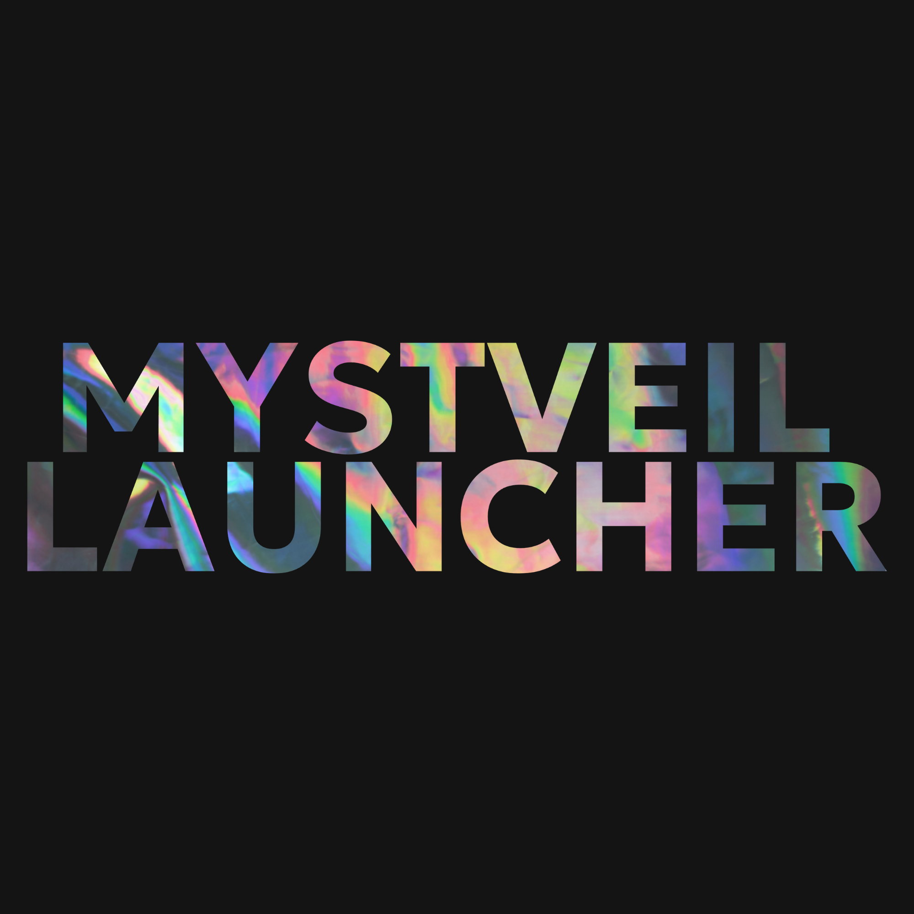
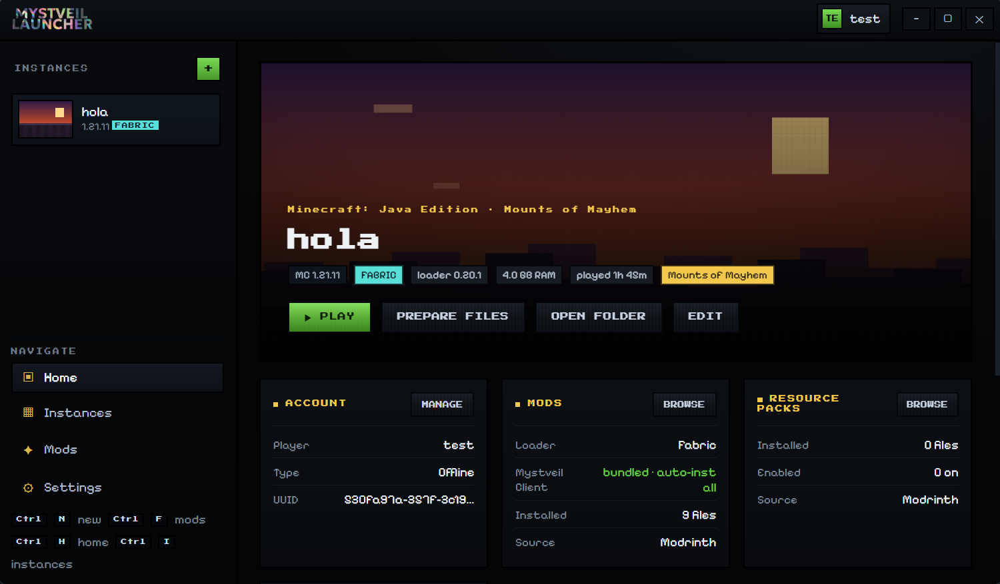
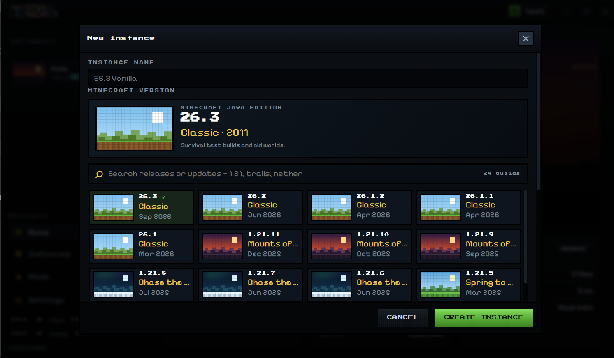
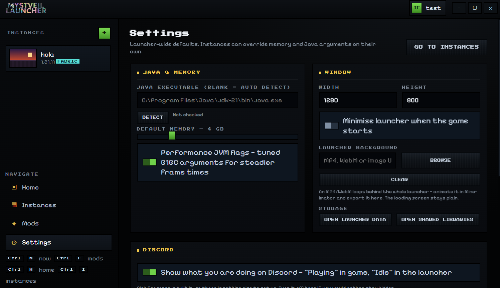

  

***A new way to experience Minecraft.***
   
  Modern design. Smooth performance. Your Minecraft, your way.

  
  
  

🌙 About Mystveil

Mystveil Launcher is a Minecraft launcher designed to provide a clean, modern, and enjoyable experience for Minecraft players.

Built with simplicity and aesthetics in mind, Mystveil aims to bring together everything you need to launch and enjoy Minecraft in one place.

Whether you're playing casually, exploring modded worlds, or enjoying your favorite servers, Mystveil is designed to make your experience better.

📸 Screenshots

Take a look at Mystveil Launcher.

  
   
  <i>Main launcher interface</i>

  
   
  <i>Instance management</i>

  
   
  <i>Launcher settings</i>

✨ Features

🎨 Modern UI – A clean and visually appealing interface.

🚀 Easy Launching – Access your Minecraft installations with ease.

⚙️ Customizable Settings – Configure your launcher experience.

🌍 Minecraft Support – Designed for Minecraft Java Edition.

🌙 Dark Aesthetic – A sleek interface inspired by the Mystveil identity.

More features coming soon!

📥 Installation

Head over to the Releases page.

Download the latest available version.

Extract the files if necessary.

Run the launcher.

Enjoy Minecraft with Mystveil!

🖥️ System Requirements

Requirement

Details

Operating System

Windows

Minecraft Edition

Java Edition

Java

Depends on Minecraft version

Internet

Required for downloads and authentication

Requirements may change as development progresses.

🛠️ Development

Mystveil Launcher is currently under development.

Features, interface elements, and functionality may change between releases.

Contributions, suggestions, and bug reports are welcome!

🐛 Bug Reports & Suggestions

Found a bug or have an idea?

Feel free to open an issue and describe the problem or suggestion.

Please include:

A description of the issue.

Steps to reproduce it.

Screenshots or logs, if available.

📜 License

This project is distributed under the license specified in this repository.

Minecraft is a trademark of Mojang Studios. Mystveil Launcher is an independent project and is not affiliated with, endorsed, or sponsored by Mojang Studios or Microsoft.
